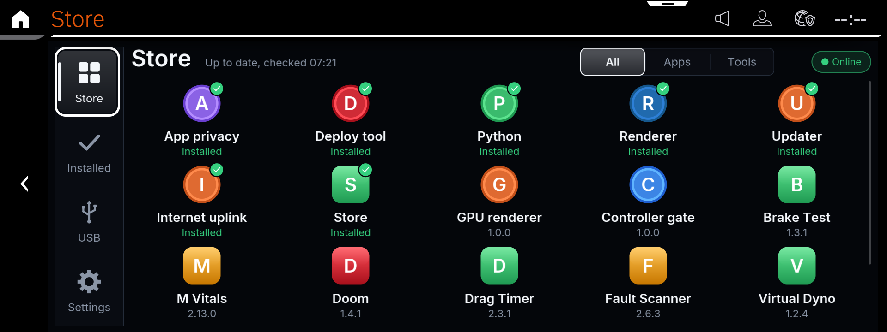
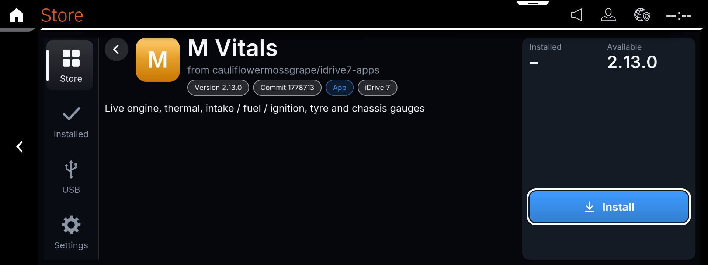
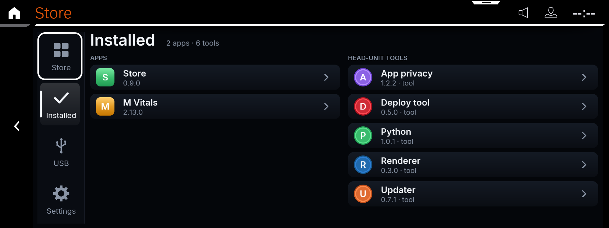
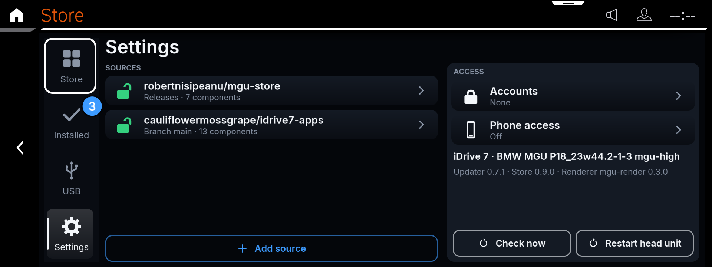
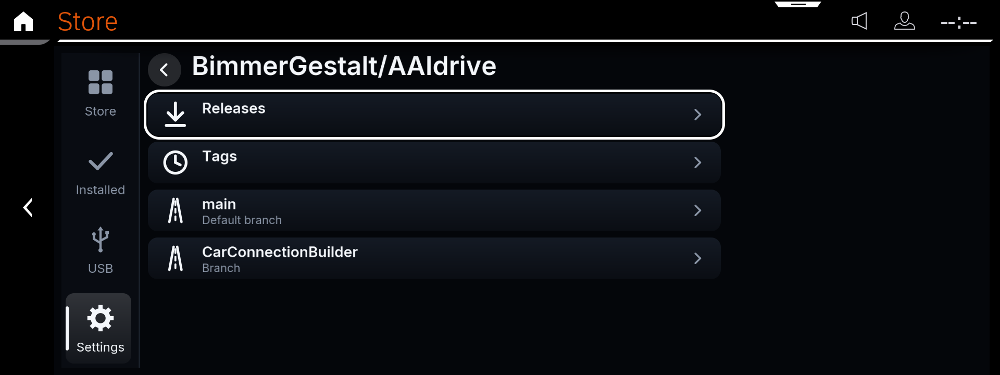
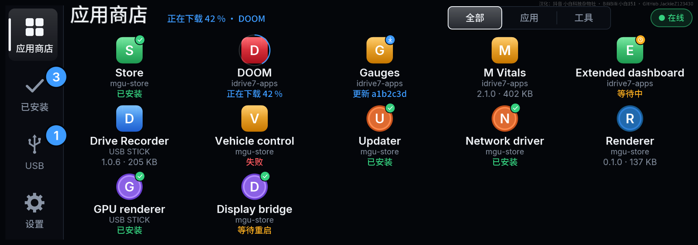
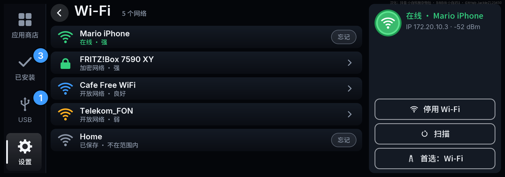

[English](README.md) | **简体中文**

# mgu-store 应用商店

**中文翻译：抖音 小白科技杂物社 · BiliBili 小白151 · GitHub [JackieZ123430](https://github.com/JackieZ123430)。**

为 BMW iDrive 7 和 iDrive 8（MGU）提供的应用商店。在车机屏幕上浏览、安装、更新和移除应用，来源可以是 GitHub 仓库、网络地址或 U 盘。

套件安装以下组件：

- **Store 商店应用**。
- **updater 更新服务**：下载并安装商店请求的内容。
- **deploy 部署工具**：执行安装并支持回滚。
- **app privacy 应用隐私组件**：防止已安装应用出现在主机向 BMW 发送的报告中。
- **renderer 渲染器**：绘制商店和其他应用的图形。
- **Python**：用于车机从源码构建的应用。
- **internet uplink 网络上行组件**：通过 USB 网卡、LTE 上网棒、手机共享或 Wi-Fi 提供网络。

iDrive 8 仅在模拟器测试，尚未实车验证。在 iDrive 8 上，安装和移除要到下次主机重启才生效。

## 截图

商店：所有来源的应用与主机工具。



应用详情：来源、版本与安装按钮。



已安装：主机上的应用、工具与版本。



设置：来源、Wi-Fi、账户和立即检查。



添加 GitHub 来源：选择发布版本、标签或分支。



以上是上游英文界面截图。中文构建和验证范围见本文末尾。

中文软件回放预览（使用仓库演示数据，非模拟器或实车截图）：





## 所需条件

- Windows 10/11、macOS 或 Linux 电脑，安装 [Node.js](https://nodejs.org) 18 及以上和 OpenSSH 客户端。
- 主机 root SSH 访问权限与 root 私钥；本文不介绍获取 root 的方法。
- 能访问主机 SSH 的连接，例如原车 Wi-Fi 热点（默认地址 `172.16.222.97`）、ENET 或其他 SSH 路由。
- 车辆停稳，安装完成前保持稳定供电。

## 安装

电脑连接原车热点或 ENET，用 root 私钥运行安装器：

```sh
# macOS、Linux
curl -fsSL https://raw.githubusercontent.com/robertnisipeanu/mgu-store/main/deploy/mgu-install.js | node - first-install --identity ~/.ssh/mgu_root_key
```

```powershell
# Windows PowerShell
irm https://raw.githubusercontent.com/robertnisipeanu/mgu-store/main/deploy/mgu-install.js -OutFile mgu-install.js; if ($?) { node mgu-install.js first-install --identity $HOME\.ssh\mgu_root_key }
```

需要 Node 18 及以上。安装器自动寻找主机并显示所用连接，提示重启时再重启主机。之后商店磁贴出现在应用列表，后续更新通过商店进行。这些上游安装命令安装上游发布版本，不自动选择本贡献的中文构建。

| 选项 | 功能 |
|---|---|
| `--identity <file>` | root SSH 私钥 |
| `--host <address>`、`--port <n>` | 指定 SSH 地址，默认端口 22；使用 SSH 配置别名时，需用 `--port` 指定其端口 |
| `--user <name>` | SSH 用户，默认 root |
| `--ssh-opt <option>` | 追加 `ssh -o` 选项，可多次使用，如 `StrictHostKeyChecking=accept-new`；跳板机同时指定主机，例如 `--host <head unit> --ssh-opt ProxyJump=<jump host>` |
| `--token` | 询问 GitHub 令牌，用于私有仓库 |
| `--no-uplink` | 不安装网络上行组件 |
| `--no-renderer` | 不安装渲染器 |

## 使用商店

侧边菜单有四页：

- **商店（Store）**：来源中的应用与工具，显示已安装、有更新、等待重启等状态。
- **已安装（Installed）**：已装内容，提供更新及全部更新。
- **USB**：当前 U 盘提供的内容。
- **设置（Settings）**：来源、Wi-Fi、账户、手机访问、立即检查与重启主机。

打开应用或工具即可安装、更新或移除。更新不会自行安装。标为“等待重启”的工具，在设置中重启主机后生效。

### 来源

默认包含本仓库和 [idrive7-apps](https://github.com/cauliflowermossgrape/idrive7-apps)。设置 → 添加来源，输入 `owner/repo`、GitHub 链接或 `catalog.json` 的 HTTPS 地址。GitHub 仓库可选择其实际拥有的发布版本、标签或某个分支。

iDrive 8 在 mgu-render 绘制商店时，添加来源和令牌会打开商店屏幕键盘。没有 mgu-render 的原生控件界面暂不支持 iDrive 8 输入，可从手机页面或电脑添加，或使用 GitHub 登录。

### 私有仓库

在设置 → 账户添加：

- **使用 GitHub 登录**：扫码、在手机输入验证码并登录；仓库还需安装 [mgu-store GitHub App](https://github.com/apps/mgu-store)。
- **添加令牌**：输入 GitHub token；用手机页面或电脑 `node mgu-install.js token --identity <key>` 比车机输入更方便。

创建细粒度令牌的方法（保留 GitHub 英文菜单名以便对照）：

1. GitHub 头像 → Settings → Developer settings → Personal access tokens → Fine-grained tokens → Generate new token。
2. 命名并选择有效期，No expiration 可避免到期影响车机访问。
3. Resource owner 选择本人账户或仓库所属组织；一个令牌对应一个所有者。
4. Repository access 选择 Only select repositories，勾选需要读取的私有仓库。
5. Permissions 添加 Contents，设为 Read-only。
6. Generate token，复制仅显示一次的 `github_pat_…`。

组织可能需要先批准令牌。其他个人账户的仓库应使用带 `repo` 范围的 classic token。

### 手机页面

设置 → 手机访问 → 开启后显示二维码。同一原车热点中的手机扫码，可查看来源、安装、错误及日志，并用手机键盘添加来源与账户。完成后关闭手机访问。

### 网络

上行组件可为更新服务和应用提供以下连接：USB 以太网适配器、LTE 上网棒（如 Huawei E3372h）、开启 USB 网络共享的 Android 手机，或开启个人热点且保持解锁的 iPhone（提示时点“信任”；共享期间 USB 音乐播放停止）。

也可在设置 → Wi-Fi 连接手机热点等网络。原车热点和无线 CarPlay 可同时工作。使用 Broadcom 无线芯片的 iDrive 7 无法连接仅 WPA3 的网络。联网后商店显示“在线”。

## 离线使用 U 盘

无网络车辆可从 U 盘安装与更新。在电脑执行：

```sh
node mgu-install.js usb-repo <stick> [github:owner/repo | <catalog URL> | <folder> | <package file> ...]
```

未指定输入时复制本仓库最新发布版本。将 U 盘插入车机后打开 USB 页面。

## 发布自己的应用

任意 GitHub 仓库或 HTTPS 地址均可作为来源，支持三种布局：

| 布局 | 内容 |
|---|---|
| Releases | GitHub release 附件中的已构建 `<id>@<version>.tgz` 或 `.mgu` |
| Catalog | 列出软件包的 `catalog.json`，放在名为 catalog 的发布版本或任意 HTTPS 地址 |
| Repo tree | 提供 `mgu-repo.json`，由主机从源码构建 |

每个应用需满足：不包含 BMW SDK（主机会链接已有 SDK）；使用带前缀的唯一 ID，例如 `acme_gauges`；声明 `mguHmi` 为 `["ID7"]`、`["ID8"]` 或两者；需要其他组件时可用 `requires` 声明并优先安装；需要互联网时在 `package.json` 设置 `"mguInternet": true`。完整指南和示例见 [docs/PUBLISHING.md](docs/PUBLISHING.md)。

## 开发

各组件 README 说明构建与测试。[deploy/README.md](deploy/README.md) 包含全部安装器命令（包括 `token --list`/`--remove`）及从检出目录安装组件的 `deploy/hu`；[release/README.md](release/README.md) 说明发布流程。

### 中文构建与署名

```sh
cd apps/robertn_store
node tools/build.js --language zh-CN
node tools/test_chinese.js
```

输出 `robertn_store@0.9.11.zh-CN.src.tgz`，默认不带参数仍为英文。中文源码包内语言固定，两种语言使用相同应用 ID 与版本，相互安装会替换；来自英文来源的普通商店更新会恢复英文。中文发布需由维护者单独提供此产物，不改变上游默认目录。

中文涵盖两套车机界面的菜单、按钮、状态、来源、账户、网络和确认页面。第三方应用名称、介绍、原始错误细节和日志保留来源文本。更新器提供的手机网页及安装器保持原语言。中文包在右上角显示低对比度汉化署名，设置列表和原生控件页也保留署名，英文包不显示中文署名。

离线测试覆盖 96 个中文帧、请求与数据保留、字形及 StringId。当前 Windows 电脑无可用 MGU 模拟器；仓库要求的 ID7/ID8 模拟器和实机显示验证仍待完成。

## 许可证

版权所有 (C) 2026 Robert Nisipeanu 和 IterioDev。项目采用 GPL-3.0-or-later，见 `LICENSE`。第三方内容保留各自许可证，见 `THIRD_PARTY_NOTICES.md`。新增 Noto Sans SC 中文字形采用 SIL OFL-1.1。

**汉化与中文文档：抖音 小白科技杂物社 / BiliBili 小白151 / GitHub JackieZ123430。原作者版权与署名保留。**
